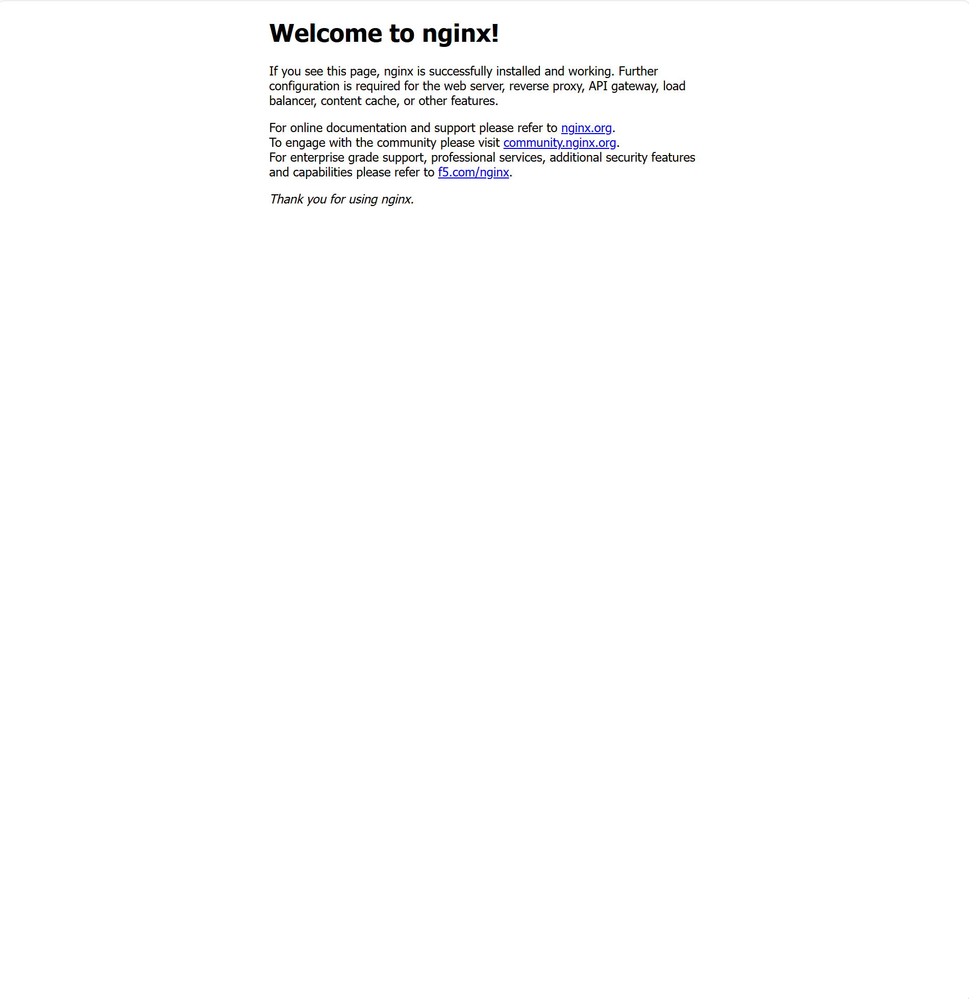
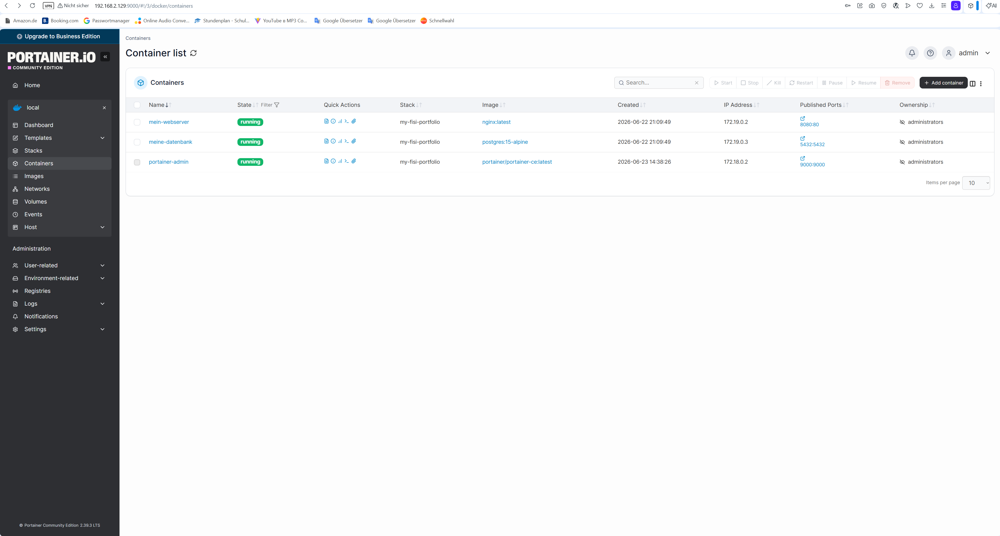

# Mein erstes IT-Infrastruktur-Projekt (FiSi Lab)

In diesem Projekt habe ich eine eigene Testumgebung (Homelab) für die Fachrichtung Systemintegration aufgebaut.

## Technische Details

- **Hypervisor:** Oracle VirtualBox
- **Betriebssystem:** Ubuntu Linux
- **Fernverwaltung:** SSH (Port 22)
- **Containerisierung:** Docker und Docker Compose
- **Webserver:** Nginx im Docker-Container (Port-Weiterleitung 8080:80)
- **Datenbank:** PostgreSQL 15 (Alpine, Port 5432)
- **Netzwerk:** Isoliertes Docker-Bridge-Netzwerk
- **GUI-Verwaltung:** Portainer CE (Port 9000)
- **Automatisierung:** Bash-Skript im Benutzer-Crontab, täglich um 20:00 Uhr

## Was ich gelernt habe

- Linux-Administration über das Terminal und Fehlerbehebung
- Docker-Container, persistente Volumes und Netzwerke
- Port-Mapping und Netzwerkdiagnose
- Bash-Scripting und Cronjob-Automatisierung
- Verwaltung und Fehleranalyse mit Portainer

## Persistente Daten und Sicherungen

- PostgreSQL verwendet das benannte Docker-Volume `postgres_data` unter `/var/lib/postgresql/data`.
- Portainer verwendet `portainer_data` unter `/data`.
- Der tägliche Sicherungsjob liegt im Benutzer-Crontab und startet `backup.sh` um 20:00 Uhr.
- Lokale Sicherungsdateien liegen unter `backups/` und sind von Git ausgeschlossen.
- Die PostgreSQL-Verbindung wurde geprüft. Die Datenbank `fisi_db` enthielt zum Prüfzeitpunkt keine Tabellen.
- Die durchgeführten Änderungen und Prüfungen sind in [docs/INFRASTRUKTUR-AENDERUNGEN-2026-10.md](docs/INFRASTRUKTUR-AENDERUNGEN-2026-10.md) dokumentiert.

### Lokale Einrichtung

1. `.env.example` nach `.env` kopieren.
2. In `.env` ein starkes, individuelles PostgreSQL-Passwort eintragen.
3. Compose-Konfiguration prüfen und die benötigten Dienste starten.

Die `.env`-Datei und echte Datenbank-Backups gehören nicht ins Repository. Das bisherige Passwort war in älteren Commits fest eingetragen. Falls es noch verwendet wird, muss es geändert werden; ein Austausch in der aktuellen Datei entfernt es nicht aus der Git-Historie.

## Screenshots der Umgebung

### Nginx-Webserver

### Portainer

